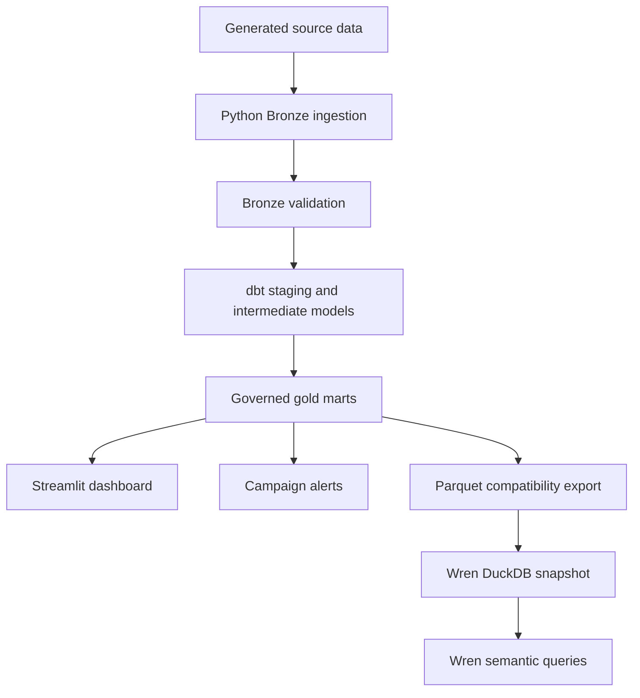

# Marketing Spend Control Tower

An end-to-end analytics engineering project for monitoring campaign performance, budget pacing, attributed revenue, and overspend risk.

The project turns raw marketing and order data into tested DuckDB marts, a Streamlit control tower, prioritised campaign alerts, and a governed Wren semantic layer for business questions.

## Business problem

Marketing teams need to know:

- How much has been spent and what revenue was attributed to it?
- Which campaigns are above or below plan?
- Which campaigns are projected to exceed budget?
- Which alerts need immediate attention?
- Can these questions be answered consistently without rewriting SQL?

This project creates one governed workflow for answering those questions.

## Validated results

| Metric | Result |
|---|---:|
| Total spend | £106,396.96 |
| Attributed net revenue | £33,856.00 |
| ROAS | 0.32x |
| Attributed conversions | 310 |
| Active campaign alerts | 2 |
| Daily performance rows | 297 |
| Daily pacing rows | 297 |

Two Meta campaigns are projected to exceed budget:

| Campaign | Budget | Projected spend | Projected ratio |
|---|---:|---:|---:|
| Meta Ads Conversions Campaign 08 | £4,000.00 | £6,791.74 | 1.70x |
| Meta Ads Awareness Campaign 12 | £12,000.00 | £17,446.50 | 1.45x |

Attributed net revenue is used as the default revenue measure. ROAS is calculated as attributed net revenue divided by spend.

## Architecture



## Technology

- Python
- DuckDB
- dbt-duckdb
- Apache Airflow
- Streamlit
- Plotly
- Pandas
- Wren AI

## Data pipeline

The pipeline follows a layered design:

1. `generator/generate_data.py` creates reproducible source data.
2. `pipeline/ingest_bronze.py` loads raw data into DuckDB.
3. `pipeline/validate_bronze.py` runs Bronze quality checks.
4. dbt builds staging, intermediate, and gold models.
5. `alerts/send_campaign_alerts.py` reads prioritised alerts.
6. `dashboard/app.py` serves the control tower.
7. Airflow orchestrates the workflow through a five-task DAG.

The Bronze validation suite contains 17 checks. The latest dbt build completed with 68 successful results.

## Governed marts

### `fct_campaign_daily_performance`

Daily campaign performance, including:

- spend
- attributed conversions
- attributed net revenue
- ROAS

### `mart_campaign_daily_pacing`

Daily budget pacing, including:

- month-to-date spend
- expected spend to date
- projected month-end spend
- pacing ratio
- projected budget breach status

### `mart_campaign_alerts`

Prioritised campaign alerts, including:

- severity
- reason
- priority
- budget
- projected spend
- pacing ratio

Lower `alert_priority` values represent more urgent alerts. A pacing ratio above `1.0` means that spend is above plan.

## Dashboard

The Streamlit dashboard provides:

- reporting-period, channel, and campaign filters
- KPI totals
- actual spend against expected spend
- spend and attributed revenue trends
- campaign performance
- current budget pacing
- campaign-level detail
- prioritised campaign alerts

The dashboard queries the governed gold marts in read-only mode and caches results for five minutes.

Run it with:

```bash
streamlit run dashboard/app.py --server.port 8501
```

Then open `http://localhost:8501`.

## Campaign alerts

Preview prioritised campaign alerts without sending an email:

```bash
python alerts/send_campaign_alerts.py
```

Email delivery is optional and uses Resend. Set the required environment variables before using the `--send` flag:

```bash
export RESEND_API_KEY="your-resend-api-key"
export ALERT_RECIPIENT="you@example.com"
python alerts/send_campaign_alerts.py --send
```

Keep API keys in environment variables and do not commit them to Git.

## Wren semantic layer

Wren exposes three governed models:

- `campaign_daily_performance`
- `campaign_daily_pacing`
- `campaign_alerts`

The semantic layer includes descriptions, data types, physical table references, and validated SQL queries.

Verified questions:

1. Which campaigns need immediate attention, and why?
2. What are total spend, attributed net revenue, and ROAS?
3. Which campaigns are projected to exceed budget, and by how much?

The saved queries are stored under `wren/knowledge/sql`.

## DuckDB compatibility workflow

The compatibility commands below assume WSL and a Wren virtual environment installed on Windows.

Set the location of your Windows Wren virtual environment:

```bash
export WREN_BIN="/mnt/c/path/to/wren-venv/Scripts"
```

The main analytics warehouse uses DuckDB 2.0.0. Wren 0.15.0 runs with DuckDB 1.5.5, so the project uses a reproducible compatibility snapshot instead of connecting Wren directly to the newer database file.

First export the current gold marts with the project environment:

```bash
python wren/export_marts.py
```

Then rebuild the Wren-compatible snapshot with Wren's Windows Python:

```bash
"$WREN_BIN/python.exe" \
  "$(wslpath -w "$(pwd)/wren/build_snapshot.py")"
```

The generated Parquet files and compatibility database are local artifacts and are excluded from Git.

Validate the Wren project:

```bash
cd wren

"$WREN_BIN/wren.exe" \
  context validate --strict

"$WREN_BIN/wren.exe" \
  context build
```

Run a semantic query:

```bash
"$WREN_BIN/wren.exe" \
  --sql "SELECT COUNT(*) AS alert_rows FROM campaign_alerts"
```

Expected result: `2`.

## Local setup

Clone the repository and create a virtual environment:

```bash
git clone https://github.com/Fuddie/marketing-spend-control-tower.git
cd marketing-spend-control-tower

python3 -m venv .venv
source .venv/bin/activate
pip install -r requirements.txt
```

Generate and ingest the data:

```bash
python generator/generate_data.py
python pipeline/ingest_bronze.py
python pipeline/validate_bronze.py
```

Build and test the dbt project:

```bash
cd dbt
dbt build --profiles-dir .
cd ..
```

Run the dashboard:

```bash
streamlit run dashboard/app.py --server.port 8501
```

## Repository structure

```text
airflow/       Airflow orchestration
alerts/        Prioritised campaign alert delivery
dashboard/     Streamlit control tower
dbt/           Transformations, marts, and tests
docs/          Business requirements and source design
generator/     Reproducible source-data generation
pipeline/      Bronze ingestion and validation
wren/          Semantic models, verified queries, and refresh scripts
```

## Reliability controls

- deterministic source-data generation
- Bronze schema and quality validation
- dbt model and reconciliation tests
- read-only dashboard queries
- cached dashboard results
- governed definitions for spend, attributed net revenue, ROAS, and pacing
- transactional Wren snapshot rebuild
- local connection files and generated databases excluded from Git

## Author

Fuad Adebisi  
[LinkedIn](https://www.linkedin.com/in/fuad-adebisi/)  
[Portfolio](https://fuddie.github.io/)
