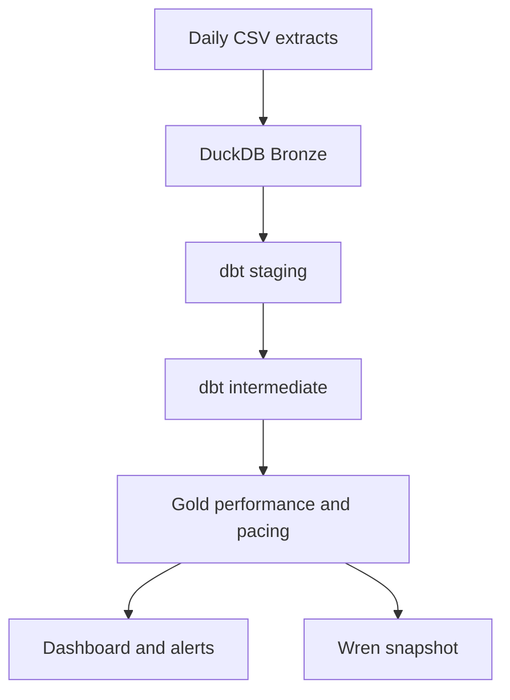

# Source design

## Overview

The project uses reproducible CSV extracts to represent data from advertising platforms, an order system, an attribution service, and a refunds process. Each extract is loaded into DuckDB before dbt applies business logic.

## Source tables

| Source | Grain | Primary key | Purpose |
|---|---|---|---|
| `campaigns` | One row per campaign | `campaign_id` | Campaign name, channel, objective, active dates, and status |
| `campaign_budget_changes` | One row per budget version | `budget_change_id` | Monthly budget allocations and revisions |
| `ad_spend_daily` | One row per campaign and spend date | `spend_record_id` | Spend, impressions, clicks, and platform conversions |
| `orders` | One row per order | `order_id` | Customer orders, status, and gross revenue |
| `attribution_events` | One row per attribution event | `attribution_id` | Last-click links between orders and campaigns |
| `refunds` | One row per refund | `refund_id` | Completed, pending, and rejected refund records |

## Landing layout

Files are partitioned by extract date:

```text
data/landing/<source_name>/extract_date=YYYY-MM-DD/<source_name>.csv
```

A load is accepted only when all six source files are present for the requested extract date.

## Bronze ingestion

`pipeline/ingest_bronze.py`:

1. Creates typed DuckDB tables in the `bronze` schema.
2. Reads each CSV into a temporary staging view.
3. Adds `extract_date`, `ingested_at`, and `source_file` metadata.
4. Updates matching primary keys when the incoming extract is current or newer.
5. Inserts new records.
6. Removes records no longer present in the current complete snapshot.
7. Commits all source loads together or rolls the transaction back on failure.

Older snapshots are rejected when a later campaign extract has already been loaded.

## Data types

- Identifiers and descriptive attributes use `VARCHAR`.
- Business dates use `DATE`.
- Event and update times use `TIMESTAMP`.
- Financial values use `DECIMAL(18, 2)`.
- Attribution weights use `DECIMAL(5, 4)`.
- Counts use `BIGINT`.

All financial source records use GBP.

## Transformation layers

### Staging

Staging models rename fields, standardise types, and apply source-level tests.

### Intermediate

- `int_campaign_budget_versions` creates effective budget windows.
- `int_attributed_order_financials` combines completed orders, last-click attribution, and completed refunds.

### Gold

- `fct_campaign_daily_performance` provides one row per campaign and metric date.
- `mart_campaign_daily_pacing` calculates running spend, expected spend, projections, ROAS, and pacing status.
- `mart_campaign_alerts` returns current warning and critical conditions in review order.

## Quality controls

Bronze validation checks:

- required tables contain data
- campaign references exist
- attribution order and campaign references exist
- refund order references exist
- campaign date ranges are valid
- budgets and order revenue are positive
- spend is non-negative
- clicks do not exceed impressions
- refunds are positive and do not exceed order revenue
- refunds occur after their orders
- last-click attribution weights equal 1.0
- touchpoints do not occur after orders
- all financial records use GBP

dbt adds uniqueness, null, accepted-value, relationship, reconciliation, campaign-date grain, and post-end spend classification tests.

## Lineage


